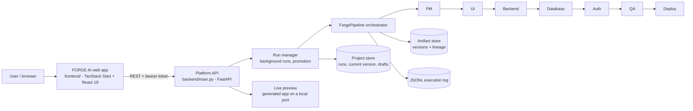
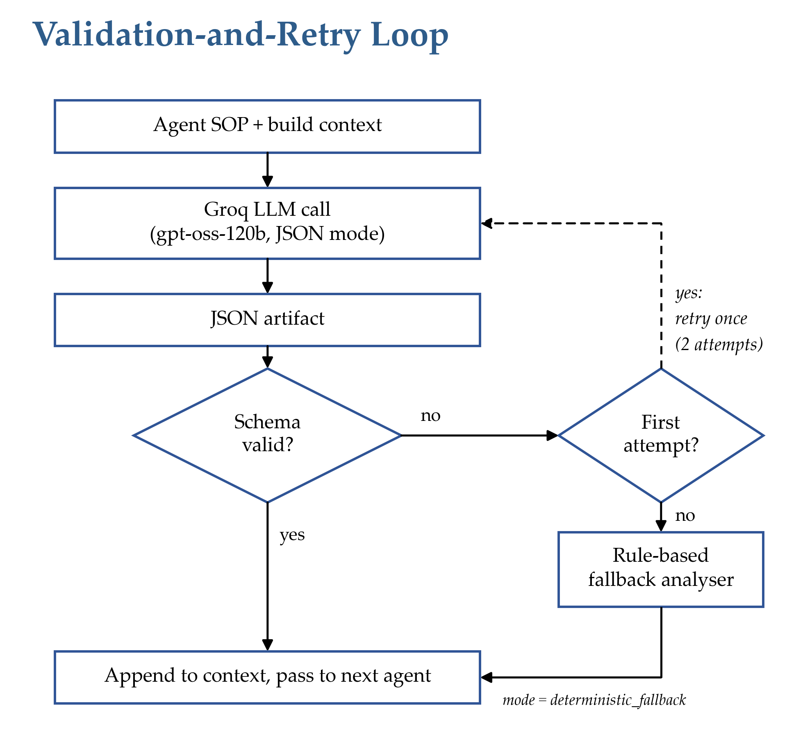

# FORGE AI — Autonomous Multi-Agent Full-Stack Application Builder

FORGE AI turns a natural-language application idea into a **working, tested, versioned full-stack
application**: a React frontend, a FastAPI REST API, a SQLAlchemy data model with PostgreSQL migrations,
JWT authentication with roles, an executed test suite and Docker deployment files.

Seven specialised agents (Project Manager, UI, Backend, Database, Authentication, QA and Deployment)
work through a central orchestrator. Each agent hands the next one a schema-validated, versioned
**artifact**. The FORGE AI web app shows every agent live, lets you preview the generated app, refine it
with plain-English change requests, and roll back to any earlier stable version.

> **Default mode is rule-based.** Without an API key, every agent runs on deterministic, prompt-driven
> analysis and code templates. An LLM (Groq, Google Gemini or any OpenAI-compatible API) can optionally
> assist the PM and UI agents. See [Environment variables](#environment-variables).

---

## Table of contents

1. [Problem statement](#problem-statement)
2. [Project objectives](#project-objectives)
3. [Key features](#key-features)
4. [System architecture](#system-architecture)
5. [The seven agents](#the-seven-agents)
6. [Technology stack](#technology-stack)
7. [Folder structure](#folder-structure)
8. [Installation and setup](#installation-and-setup)
9. [Environment variables](#environment-variables)
10. [Starting the backend](#starting-the-backend)
11. [Starting the frontend](#starting-the-frontend)
12. [Application generation workflow](#application-generation-workflow)
13. [Live preview](#live-preview)
14. [API endpoints](#api-endpoints)
15. [Testing](#testing)
16. [Screenshots](#screenshots)
17. [Known limitations](#known-limitations)
18. [Future enhancements](#future-enhancements)
19. [Contributors](#contributors)
20. [License](#license)

---

## Problem statement

Building even a simple data-management application needs several kinds of work: gathering
requirements, designing screens, writing an API, modelling the database, securing access, testing and
packaging for deployment. Each step is usually done by hand, often by different people, and mistakes
between steps (a screen calling an endpoint that does not exist, an API field with no database column)
are found late.

Single-prompt AI code generators speed up the first draft, but their output is often not run, not
tested, and hard to change safely afterwards. There is usually no record of how a result was produced
and no way back to a previous working version.

FORGE AI addresses this by splitting generation across specialised agents that check each other's
output, **executing** the generated tests before anything is published, and keeping every version so a
bad change can be undone.

## Project objectives

| # | Objective | Implemented as |
|---|---|---|
| 1 | **Multi-agent AI orchestration** | Seven agents in a dependency-ordered pipeline (`backend/services/pipeline.py`) with Pydantic artifact contracts, artifact lineage, cross-agent contract checks, retries and failure isolation |
| 2 | **Automated full-stack application generation** | Each agent writes the files it owns (`backend/codegen/`). QA runs the generated test suite and checks; Deploy health-checks the running app |
| 3 | **Monitoring, logging and rollback** | Structured JSONL events, a live progress API and web workspace, versioned artifacts, SHA-256-verified promotion of stable versions, and project- and artifact-level rollback (`backend/monitoring/`, `backend/services/project_store.py`, `backend/artifacts/rollback_manager.py`) |

## Key features

All features below are implemented in this repository. Planned work is listed separately under
[Future enhancements](#future-enhancements).

**Generation**
- Natural-language prompt (15 to 20,000 characters) → complete application: React frontend, FastAPI
  API, SQLAlchemy models, PostgreSQL migration, JWT auth with role-based access, tests and Docker files.
- Requirement analysis that reads plain sentences, bullet documents and numbered specifications. It
  extracts records (entities), fields, relations, roles, permissions, workflows, business rules, dashboard
  figures and seed data (`backend/agents/spec_extraction.py`).
- Optional LLM assistance for the PM and UI agents (Groq, Gemini or an OpenAI-compatible API). Output is
  validated and normalised, retried once, and falls back to the rule-based analyser if it is still invalid.

**Quality and safety**
- QA **executes** eight checks per build:
  1. Python syntax
  2. Application import and route registration
  3. UI/API contract (frontend calls exist in the backend)
  4. Requirement coverage (specification vs generated app)
  5. PostgreSQL DDL compilation
  6. The generated pytest suite
  7. Frontend module imports resolve
  8. A `vite build` of the generated frontend (can be switched off)
- A failing check fails the build. Deploy is then skipped and the previous stable version stays live.
- Deploy writes Docker and Compose files and health-checks the generated app as a running process.

**Versions and iteration**
- Every successful build is promoted to a numbered stable version, verified against a SHA-256 manifest.
- **Rollback** to any earlier stable version (files and all seven artifacts), or of a single agent's artifact.
- **Iterative refinement**: describe a change ("Add a phone field to members", "Remove the fines
  module"). The PM agent writes a change plan, only the affected agents run, and the others reuse their
  previous output. Schema changes become incremental migrations (`00N_<change>.sql` with a `.down.sql`).
  QA adds a regression check against the previous version, and a `CHANGELOG.md` is kept.
- **Plan preview** before applying: the change plan, data-loss warnings, the migration SQL and the exact
  file changes. Applying runs exactly the approved plan; drafts expire after one hour.
- **Rebuild** from a full new description (regenerates the whole application).

**Platform**
- Accounts with PBKDF2-hashed passwords and signed bearer tokens. Every project is private to its owner.
- Dashboard with build statistics (builds, success rate, average build time, tests, a 14-day chart),
  project cards, search (Ctrl+K) and project deletion.
- Project workspace with:
  - a live pipeline graph and agent cards;
  - an activity log, an artifact viewer and a file browser;
  - test and deploy reports, a live preview and version history;
  - for refinements, a **Changes** tab.
- ZIP download of any build, and **Push to GitHub**: a new or existing repository, one commit. The token
  is used only for that request and never stored.
- Test mode that injects a failure into a chosen agent, to demonstrate failure isolation and rollback.

## System architecture



**How a build flows**

1. The web app sends the prompt to the platform API, which creates a project and starts a run in the
   background (`backend/services/run_manager.py`; two concurrent runs by default).
2. `ForgePipeline` (`backend/services/pipeline.py`) runs the agents in order. Each agent:
   - loads the upstream artifacts of **this run**;
   - generates its specification and validates it against its Pydantic schema (`backend/schemas/`);
   - saves it as a versioned artifact (`backend/artifacts/`);
   - writes the files it owns (`backend/codegen/`).
3. Agent states move through `PENDING → RUNNING → COMPLETED | FAILED`. A transient error causes one
   retry (`RETRYING`), and agents after a failure are `SKIPPED`.
4. A fully successful run is **promoted**: its files are checked against `forge_manifest.json` (SHA-256
   per file) and copied into the project's `current/` folder as a new version. A failed run never changes
   `current/`.

**Workspace layout (git-ignored)**

```text
workspace/
├── users.json                 platform accounts (hashed passwords)
├── artifacts/                 versioned agent artifacts with lineage
├── logs/                      pipeline execution events (JSONL)
├── node_modules/              shared React/Vite toolchain for QA builds and previews
└── projects/<project_id>/
    ├── project.json           owner, versions, runs, GitHub link (never a token)
    ├── runs/<run_id>/{app, specs, run.json}
    ├── current/               the live (stable) version
    ├── drafts/                refinement plans awaiting approval (1-hour TTL)
    └── preview_data/          database of the live preview
```

**LLM validation-and-retry loop (PM agent)**



## The seven agents

Only the **PM** and **UI** agents can call an LLM. The other five always generate their output from
the validated specification with deterministic code templates.

| Agent | Consumes | Produces (artifact) | Writes (files it owns in the generated app) |
|---|---|---|---|
| **Project Manager** (`pm_agent.py`) | User prompt (and, for refinements, the live specification) | `requirements.json`: entities, fields, relations, access policies, roles, permissions, modules, workflows, business rules, dashboard metrics, seed data, requirement trace; for refinements a change plan | `docs/REQUIREMENTS.md`, `docs/CHANGELOG.md` |
| **UI** (`ui_agent.py`) | Requirements | `ui_spec.json`: pages, routes, forms, components, API needs, theme | `frontend/`: React 18 + Vite app with routing, layout, CRUD pages with search, filters and pagination, dashboards |
| **Backend** (`backend_agent.py`) | Requirements, UI spec | `api_spec.json`: endpoints, schemas, permissions, row-level scopes. **Fails if the UI needs an endpoint the API does not provide.** | `backend/app/main.py`, `schemas.py`, `routers/*`, business-rule runtime |
| **Database** (`db_agent.py`) | Requirements, API spec | `database_schema.json`: tables, columns, foreign keys, CHECK/UNIQUE constraints, indexes. **Fails if an API field has no column.** | `models.py` (SQLAlchemy 2), `database.py`, `migrations/001_initial_schema.sql` (+ incremental migrations on refinement) |
| **Authentication** (`auth_agent.py`) | Requirements, API spec, DB schema | `auth_spec.json`: password policy, JWT strategy, role/permission matrix | `security.py` (PBKDF2 hashing, HS256 JWT, permission checks), auth and user-management routers, admin seed, React auth context, login and register pages |
| **QA** (`qa_agent.py`) | All specs and files | `qa_report.json`: every executed check, per-test results, classified errors, the responsible agent, repair recommendations | `backend/tests/*`: auth, CRUD, validation, search/filter, RBAC, ownership isolation, references, workflows, business rules |
| **Deployment** (`deploy_agent.py`) | Specs and QA report | `deployment_report.json`: readiness checks, live health checks, instructions | `backend/Dockerfile`, `frontend/Dockerfile`, `frontend/nginx.conf`, `docker-compose.yml` (with PostgreSQL), `.env.example`, `README.md` |

## Technology stack

**FORGE AI platform**

| Layer | Technology | Version |
|---|---|---|
| API | Python, FastAPI, Uvicorn, Pydantic 2 | Python 3.11+ required (tested on 3.13); FastAPI ≥ 0.110 (tested 0.136); Uvicorn ≥ 0.27; Pydantic ≥ 2.5 |
| Data and HTTP | SQLAlchemy 2 (generated-app runtime), httpx (Groq, GitHub), python-dotenv, PyYAML | see `requirements.txt` |
| Optional LLM | Groq (OpenAI-compatible chat API, default model `openai/gpt-oss-120b`), Google Gemini via `google-generativeai` (default `gemini-2.5-flash`), any OpenAI-compatible API | — |
| Web app | React 19, TanStack Start / Router / Query, Vite 8, TypeScript 5, Tailwind CSS 4, shadcn/ui (Radix), Recharts, cmdk, Sonner, lucide-react | Node.js ≥ 22.12 (`frontend/package.json`) |
| Tests | pytest (backend), Vitest + Testing Library (frontend) | — |
| Containers | Docker, Docker Compose (`docker/`, `docker-compose.yml`) | optional |

**Generated applications**

| Layer | Technology |
|---|---|
| Frontend | React 18, React Router 6, Vite 5 |
| Backend | FastAPI, SQLAlchemy 2, Pydantic 2 |
| Database | PostgreSQL in Docker Compose; SQLite for local tests and previews |
| Auth | PBKDF2-SHA256 password hashing, HS256 JWT, role-based permissions |
| Deployment | Dockerfiles, nginx, Docker Compose |

## Folder structure

```text
Forge-AI/
├── backend/
│   ├── main.py               FastAPI platform API (accounts, projects, runs, artifacts, previews)
│   ├── config.py             settings; loads backend/.env
│   ├── agents/               the seven agents, rule-based requirement analysis, change requests and plans
│   ├── codegen/              blueprint + code writers (frontend, backend, db, auth, QA, deploy, migrations)
│   ├── schemas/              Pydantic contracts for every agent artifact
│   ├── artifacts/            artifact store, manager, run context, rollback manager
│   ├── services/             pipeline, run manager, project store, preview, toolchain, GitHub
│   │                         publisher, refine preview, dashboard insights, failure classifier
│   ├── monitoring/           execution events, JSONL logger (with secret redaction), queries
│   ├── llm/                  LLM clients (Gemini, Groq / OpenAI-compatible) and JSON extraction
│   └── auth/                 platform accounts: password hashing, tokens, user store
├── frontend/                 FORGE AI web app (not a generated app)
│   └── src/
│       ├── routes/           /, /login, /signup, /app (dashboard), /app/new, /app/projects/$projectId
│       ├── components/app/   app shell, pipeline graph, refine flow, changes, files, preview, versions…
│       ├── lib/api/          typed API client
│       └── test/             Vitest tests
├── tests/                    backend pytest suite (+ tests/prompts/ sample requirement documents)
├── docker/                   Dockerfile.backend, Dockerfile.frontend
├── docs/                     project report, figures, implementation notes
├── docker-compose.yml        runs the platform itself (API :8000, web app :3000)
├── requirements.txt          backend dependencies
├── pytest.ini
├── .env.example              platform settings template (copy to backend/.env)
└── workspace/                (git-ignored) generated projects, artifacts, logs, shared toolchain
```

## Installation and setup

**Prerequisites**

- Python **3.11 or newer**
- Node.js **22.12 or newer**, with npm. Used by the web app and for building generated frontends.
- Git
- Docker Desktop (optional; only for the container setup)

**1. Clone the repository**

```powershell
git clone https://github.com/Priyaa056/Forge-AI.git
```
```powershell
cd Forge-AI
```

**2. (Recommended) Create a virtual environment**

```powershell
python -m venv .venv
```
```powershell
.\.venv\Scripts\Activate.ps1
```

**3. Install backend dependencies**

```powershell
pip install -r requirements.txt
```

**4. Install frontend dependencies**

```powershell
npm ci --prefix frontend
```

**5. (Optional) Create your settings file.** This is only needed for an LLM or to change defaults:

```powershell
Copy-Item .env.example backend\.env
```

The commands are written one per line so they also work in Windows PowerShell 5.1, which has no `&&`.

## Environment variables

Settings are read from `backend/.env` (preferred) or a `.env` file in the repository root. The template
is [`.env.example`](.env.example). **Never commit a real `.env` file or paste API keys into
`.env.example`**: `*.env` is git-ignored and only `.env.example` is tracked. Provider keys are removed from
the environment of generated apps and redacted from logs.

**LLM (optional)**

| Variable | Default | Purpose |
|---|---|---|
| `USE_LLM` | `false` | `true` lets the PM and UI agents call the configured LLM |
| `LLM_PROVIDER` | `gemini` | `groq`, `gemini` or `openai_compatible` |
| `GROQ_API_KEY` | — | Groq key (create one at console.groq.com/keys) |
| `GROQ_MODEL` | `openai/gpt-oss-120b` | Groq model |
| `GOOGLE_API_KEY` | — | Gemini key |
| `GEMINI_MODEL` | `gemini-2.5-flash` | Gemini model |
| `LLM_BASE_URL`, `LLM_API_KEY`, `LLM_MODEL` | — | Any OpenAI-compatible chat API (e.g. OpenRouter) |
| `LLM_MAX_TOKENS` | not set | Optional cap on each LLM reply |

Example `backend/.env` for Groq (placeholder value, not a real key):

```dotenv
USE_LLM=true
LLM_PROVIDER=groq
GROQ_API_KEY=your_groq_api_key_here
```

**Platform**

| Variable | Default | Purpose |
|---|---|---|
| `FORGE_WORKSPACE` | `./workspace` | Where projects, artifacts, logs, accounts and the toolchain are stored |
| `FORGE_QA_FRONTEND_BUILD` | `true` | Run `vite build` on every generated frontend during QA |
| `FORGE_ALLOW_FAULT_INJECTION` | `true` | Allow the "simulate failure" test mode |
| `FORGE_MAX_CONCURRENT_RUNS` | `2` | Builds that may run at the same time |
| `FORGE_SECRET_KEY` | generated once into the workspace | Signing key for platform login tokens |
| `FORGE_TOKEN_TTL_MINUTES` | `720` (12 h) | Platform login token lifetime |
| `FORGE_PASSWORD_ITERATIONS` | `200000` | PBKDF2 iterations for platform passwords |
| `FORGE_TOOLCHAIN_DIR` | the workspace | Location of the shared `node_modules` used for generated frontends |

**Web app**

| Variable | Default | Purpose |
|---|---|---|
| `VITE_API_BASE_URL` | `http://127.0.0.1:8000` | Platform API address used by `frontend/src/lib/api/client.ts`; set it in `frontend/.env` (template: `frontend/.env.example`) |

## Starting the backend

From the repository root, with the virtual environment active:

```powershell
python -m uvicorn backend.main:app --host 127.0.0.1 --port 8000
```

Check that it is running:

- http://127.0.0.1:8000/health returns the service status.
- http://127.0.0.1:8000/docs is the interactive OpenAPI documentation.
- http://127.0.0.1:8000/api/system shows the generation mode (rule-based or LLM) and the available tools.

Restart the API after changing `backend/.env`.

## Starting the frontend

In a second terminal, from the repository root:

```powershell
cd frontend
```
```powershell
npm run dev -- --host 127.0.0.1 --port 3000
```

Open http://127.0.0.1:3000, sign up, and create a project. Vite may print a notice about
`vite-tsconfig-paths` from the original Lovable configuration; it is harmless.

For a production build of the web app, run `npm run build` in `frontend/`.

**Docker alternative (platform only)**

```powershell
Copy-Item .env.example .env
```
```powershell
docker compose up --build
```

This starts the web app on port 3000 and the API on port 8000. Two limitations:

- The Compose file currently forwards only `USE_LLM`, `GOOGLE_API_KEY`, `GEMINI_MODEL`,
  `FORGE_QA_FRONTEND_BUILD` and `FORGE_SECRET_KEY` to the API container, so Groq settings are not
  passed through.
- Live previews of generated apps run inside the API container and are not reachable from the host.

## Application generation workflow

1. **Describe the app.** On **New project**, enter a prompt. For example: *"Build a library management
   system with members, books, loans with due dates, fines for late returns and an admin dashboard
   showing overdue loans."*
2. **Watch the build.** The workspace shows the pipeline graph: the working agent pulses, finished agents
   show their duration, and each agent's artifact can be opened. With the default settings, a rule-based
   build takes about 30 seconds on a laptop. Most of that is QA running the generated tests and the
   frontend build; refinements that reuse agents finish faster. The first build on a machine also installs
   the shared frontend toolchain (about 30 s, once).
3. **QA decides.** If every QA check passes, Deploy health-checks the app and the build becomes the next
   live version (v1, v2, …). If not, the build is marked failed with the responsible agent, and the
   previous version stays live.
4. **Explore the result.** Browse the generated files and the test and deploy reports, open the live
   preview, download a ZIP, or push to GitHub.
5. **Refine.** Click **Refine app** and describe a change. Review the plan preview (affected agents, data
   warnings, migration, file changes) and click **Apply**. Unaffected agents are shown as reused (dashed in
   the pipeline graph). The **Changes** tab lists what changed and the regression check result.
6. **Roll back** from **Versions** to any earlier stable version if needed.

## Live preview

The **Preview** tab runs the project's live version as a real process
(`backend/services/preview.py`, `backend/services/app_runner.py`):

- The generated frontend is built with `vite build` (using the shared toolchain), then a Uvicorn process
  serves the generated API and the built frontend together on a **free local port**.
- The preview uses its own SQLite database (`preview_data/`) and a per-project admin account. Its
  credentials are shown in the workspace and are local-only.
- Platform secrets and LLM keys are removed from the preview's environment.
- Previews can be started and stopped from the workspace or through the API. They are reachable only
  from the machine running FORGE AI.

## API endpoints

All `/api/*` endpoints except register and login need an `Authorization: Bearer <token>` header. Other
users' projects return `404`. Full request and response schemas are available at `/docs`.

**Service and accounts**

| Method | Path | Purpose |
|---|---|---|
| GET | `/` | Service status and the docs URL |
| GET | `/health` | Health check |
| GET | `/api/system` | Generation mode, LLM provider, toolchain/Node/Docker availability, agents |
| POST | `/api/auth/register` | Create an account and return a token |
| POST | `/api/auth/login` | Sign in and return a token |
| GET | `/api/auth/me` | The signed-in user |

**Projects and builds**

| Method | Path | Purpose |
|---|---|---|
| POST | `/api/pm/generate` | Run only the PM agent's requirement analysis (no project created) |
| POST | `/api/projects` | Create a project from a prompt and start its first build |
| GET | `/api/projects` | List the caller's projects (with last-build details for the dashboard) |
| GET | `/api/stats?days=14` | Dashboard statistics (7–90 days) |
| GET | `/api/projects/{project_id}` | Project details, runs and versions |
| DELETE | `/api/projects/{project_id}` | Permanently delete a project with its runs, files, artifacts and preview |
| POST | `/api/projects/{project_id}/runs` | Rebuild from a full new description |
| GET | `/api/projects/{project_id}/runs/{run_id}` | Live status of a build (agents, progress, QA, promotion) |
| GET | `/api/projects/{project_id}/runs/{run_id}/events` | Activity events of a build |
| GET | `/api/projects/{project_id}/events` | Recent events across the project |

**Refinement**

| Method | Path | Purpose |
|---|---|---|
| POST | `/api/projects/{project_id}/refine/preview` | Plan a change without applying it: plan, data warnings, migration, file changes |
| POST | `/api/projects/{project_id}/refine` | Apply a change request, or a previewed plan by `draft_id` |
| GET | `/api/projects/{project_id}/runs/{run_id}/changes` | What a refinement changed, with the regression check |

**Artifacts, files and output**

| Method | Path | Purpose |
|---|---|---|
| GET | `/api/projects/{project_id}/runs/{run_id}/artifacts` | Artifacts produced by a build |
| GET | `/api/artifacts/{artifact_id}` | One artifact |
| GET | `/api/projects/{project_id}/artifacts/{agent_name}/versions` | Version history of one agent's artifact |
| GET | `/api/projects/{project_id}/runs/{run_id}/specs/{agent_name}` | An agent's specification for a build |
| GET | `/api/projects/{project_id}/runs/{run_id}/files` | Generated file list |
| GET | `/api/projects/{project_id}/runs/{run_id}/files/content?path=…` | Content of one generated file |
| GET | `/api/projects/{project_id}/runs/{run_id}/download` | ZIP of a build |
| POST | `/api/projects/{project_id}/github/push` | Push the live version to a new or existing GitHub repository |

**Versions and preview**

| Method | Path | Purpose |
|---|---|---|
| POST | `/api/projects/{project_id}/rollback` | Restore an earlier stable version (files and all artifacts, checksum-verified) |
| POST | `/api/projects/{project_id}/runs/{run_id}/rollback` | Roll back one agent's artifact to an earlier version |
| GET | `/api/projects/{project_id}/preview` | Preview status and URL |
| POST | `/api/projects/{project_id}/preview/start` | Start the live preview |
| POST | `/api/projects/{project_id}/preview/stop` | Stop the live preview |

## Testing

**Backend** (from the repository root):

```powershell
python -m pytest
```

The suite has **241 tests in 33 files** under `tests/` and takes about 5–6 minutes. Its slower tests
run real end-to-end generations, including generated test suites and health checks. It covers:

- platform accounts and project ownership;
- requirement analysis across many domains and phrasings;
- refinement and plan preview;
- code generation and cross-agent contracts;
- orchestration and failure isolation;
- the artifact store and rollback;
- the API lifecycle;
- the LLM clients (with fake clients and a mocked HTTP transport; no real API calls);
- GitHub publishing (with a fake GitHub API);
- monitoring and secret redaction.

Tests ignore any `backend/.env` settings and never call a real LLM.

**Frontend** (in `frontend/`):

```powershell
cd frontend
```
```powershell
npm run test
```

The Vitest suite has **51 tests in 8 files** under `frontend/src/test/`. It covers page routing, the API
client, the dashboard, project deletion, GitHub push, refinement and plan preview, and the pipeline graph.

## Screenshots

> Placeholders: add images to `docs/screenshots/` and uncomment the lines below.

| Screen | Suggested file |
|---|---|
| Landing page | `docs/screenshots/landing.png` |
| Dashboard with statistics and project cards | `docs/screenshots/dashboard.png` |
| New project prompt | `docs/screenshots/new-project.png` |
| Workspace with the live pipeline graph | `docs/screenshots/workspace-pipeline.png` |
| Refinement plan preview | `docs/screenshots/refine-plan.png` |
| Live preview of a generated app | `docs/screenshots/preview.png` |
| Version history and rollback | `docs/screenshots/versions.png` |

<!--


-->

## Known limitations

- **Docker images are not built or run by FORGE AI.** Deploy writes and validates the Docker and Compose
  files and health-checks the app as a local process. Reports state `container_build_verified: false`.
- **PostgreSQL is not exercised live.** Generated models compile to PostgreSQL DDL (checked by QA), and
  the generated Compose file provisions PostgreSQL. Tests and previews use SQLite through the same
  SQLAlchemy code.
- **Generated apps are data-management (CRUD) applications:** records, relations, roles, ownership,
  workflows, rules, search and dashboards. When a prompt asks for something outside this scope, the PM
  agent reports it as unsupported instead of generating it. This covers file uploads, online payments
  and checkout, e-mail/SMS notifications, real-time chat, maps/GPS, video, AI predictions, PDF/Excel
  export, multi-language support, password recovery, and marketing landing pages.
- **Rule-based mode reads common phrasings only.** For example, a two-item list without a comma ("with
  patients and appointments") is not yet recognised.
- **LLM mode:**
  - the reply can vary between runs and occasionally leaves a record out;
  - Groq's free tier allows roughly one specification per minute; when limited, the agent falls back to rules;
  - LLM calls add time: in our Groq tests, builds took 18–40 s even with the frontend build switched off.
- **Builds cannot be cancelled** once started.
- **Previews run on random local ports** and are reachable only from the machine running FORGE AI.
- **Accounts:** no password recovery or e-mail verification. The login token is kept in the browser's
  `localStorage` and expires after 12 hours.

## Future enhancements

These are **planned, not implemented**:

- Restore requested records the LLM leaves out by cross-checking its specification with the rule-based analysis.
- Add the validation error to the prompt on LLM retries, so the model can correct itself.
- Recognise more phrasings in rule-based mode (two-item lists without commas, more domain words).
- Pass all LLM provider settings through Docker Compose.
- Build and run the generated Docker images as part of Deploy, and deploy to a cloud host.
- Cancel a running build.
- Password recovery and e-mail verification for platform accounts.
- Generated features beyond CRUD: file uploads, e-mail notifications, payments.

## Contributors

Commit authors in this repository's history:

| Git author | Role |
|---|---|
| Priyaa056 | _to be filled in_ |
| priya | _to be filled in_ |
| Supriya S A | _to be filled in_ |
| vinithacpoojary | _to be filled in_ |
| Member 4 / QA & DevOps Engineer | QA & DevOps Engineer |

## License

This repository does not include a license file yet. Until one is added, the default copyright rules
apply and others may not reuse the code. To allow reuse, add a `LICENSE` file (for example MIT or
Apache-2.0) and update this section.
